# ACEest Fitness & Gym: CI/CD pipeline

DevOps (CSIZG514/SEZG514), Assignment 1
Himanshu Pandey · 2026ht66008

This repo takes ACEest's old Tkinter gym-management scripts, ports them to a Flask web app, and runs them through a CI/CD pipeline:

- **GitHub Actions** checks every push and pull request.
- **Jenkins**, on the Prayogshala VM, builds, tests, scans and deploys everything that lands on `main`.

Links:

- Repo: https://github.com/2026ht66008/2026ht66008-aceest-devops
- Staging: http://10.3.25.101:5001
- Production: http://10.3.25.101:5000
- Jenkins: http://10.3.25.101:8080 (job `ACEest-Fitness`)
- SonarQube: http://10.3.25.101:9000 (project `aceest-fitness`)

The 10.3.x.x addresses only work inside the Prayogshala network.

## The app

The original desktop program came in ten versions. Each one was ported to Flask with the same features and added to the repo one at a time. Each version went in on its own branch and was tagged after merging.

| Tag | What it added |
|---|---|
| v1.0 | Program viewer: workout and diet plans for Fat Loss, Muscle Gain and Beginner |
| v1.1 | Client profile and calorie estimate |
| v1.1.2 | Client list, coach notes, CSV export, progress chart |
| v2.0.1 | SQLite: save and load clients, weekly progress |
| v2.1.2 | Same as 2.0.1 (the original file was identical) |
| v2.2.1 | Weekly adherence chart |
| v2.2.4 | Goals, workouts, body metrics, BMI, weight chart, workout history |
| v3.0.1 | Same as 2.2.4 (the original file was identical) |
| v3.1.2 | Login, membership expiry, AI workout generator, PDF report |
| v3.2.4 | Dashboard with program templates, membership check and a workouts tab |

Every version has:

- HTML pages
- a small JSON API under `/api/`
- a `/health` endpoint that returns the version. Jenkins uses it to check that a deployment actually came up.

From v3.1.2 onwards there's a login screen. The default is `admin` / `admin`; you can change it with the `ACEEST_ADMIN_PASSWORD` environment variable.

## Running it

```bash
python3 -m venv venv
source venv/bin/activate
pip install -r requirements.txt
python -m flask --app app run --debug    # http://127.0.0.1:5000
python -m pytest -v                       # 43 tests for v3.2.4
```

With Docker:

```bash
docker build -t aceest-app .
docker run --rm aceest-app python -m pytest -v   # tests inside the image
docker run -d -p 5000:5000 aceest-app
```

The Dockerfile is deliberately small:

- `python:3.12-slim` as the base
- requirements installed first, so Docker can reuse that layer when only the code changes
- no pip cache
- a `.dockerignore`, so the git history, the venv and the screenshots stay out of the image
- a non-root user
- gunicorn instead of Flask's development server

## How changes get in

- `main` is protected. Nothing goes in without a pull request, and the `build-and-test` check has to pass first.
- Each version had its own `feature/vX` branch. The pipeline files went in on `ci/pipeline`, and docs went in on `docs/...` branches.
- After each merge I pulled `main` and put an annotated tag on the merge commit.

## GitHub Actions

`.github/workflows/main.yml` runs on every push and pull request. It has one job, `build-and-test`:

1. **Build & lint:** install the requirements, compile-check `app.py`, run flake8.
2. **Build the Docker image.**
3. **Run pytest inside the container.**

## Jenkins

| Stage | What it does |
|---|---|
| Checkout | Wipe the workspace and clone fresh from GitHub |
| Build | New virtual environment, install requirements |
| Test | Pytest, with results published to Jenkins |
| SonarQube Quality Gate | Code analysis; the build stops if the gate fails |
| Docker Build | Image tagged with the build number |
| Test in Container | Pytest again, inside the image |
| Deploy to Staging | Run the image on port 5001 and check `/health` |
| Deploy to Production | Same image on port 5000, and check `/health` |

- **Builds start by themselves.** Jenkins checks GitHub every 2 minutes, so a merge to `main` gets built and deployed without anyone clicking *Build Now*.
- **A failure stops the release.** If any stage fails, nothing after it runs, so a broken test can't reach staging or production.
- **Rollback is easy.** Every build's image is kept and tagged with its build number, so rolling back just means running an older tag.

## Setting up Prayogshala

The VM I got was a fresh Rocky Linux 9.5 machine. Jenkins was already running, but SonarQube wasn't installed, so I set that part up myself:

- started SonarQube Community in Docker (`sonarqube:community`, with `--restart unless-stopped`), after raising `vm.max_map_count`
- installed SonarScanner CLI in `/opt/sonar-scanner`, which is where the Jenkinsfile expects it
- added the `jenkins` user to the `docker` group, so the pipeline can build and run containers
- created a SonarQube token and saved it in Jenkins as a secret-text credential called `sonar-token`

A side effect worth knowing: the VM has Python 3.9 and the Docker image uses 3.12. So the Test stage and the Test in Container stage check the code on two different Python versions.

## Problems I ran into

- **The first Actions run on the `ci/pipeline` PR failed within seconds.** I had branched it off before the v1.0 PR was merged, so that branch had no `requirements.txt`. Merging `main` into `ci/pipeline` fixed it; that's the "Merge main into ci/pipeline" commit in the history.
- **The ruleset on `main` blocked my first merges even though the checks were green.** It was waiting for an approving review, and nobody else could give one. I changed it so that only the passing check is required.
- **I missed a couple of tags early on (v1.1 and v1.1.2) and had to add them afterwards.** Since then the order is always: merge on GitHub, then `git pull`, then tag.

## SonarQube result

The quality gate passed (default gate) on 705 lines of code. SonarQube still lists 2 security, 1 reliability and 12 maintainability issues on the overall code. Coverage shows 0% because I'm not sending the coverage report to SonarQube yet.

## What I'd do next

- send pytest coverage (`pytest-cov` → `coverage.xml`) to SonarQube
- go through the open SonarQube issues
- mount a volume for the SQLite file, because right now every deploy starts with an empty database
- set a real secret key and admin password through environment variables on the server

## Screenshots

### Jenkins

Build #1, finished:

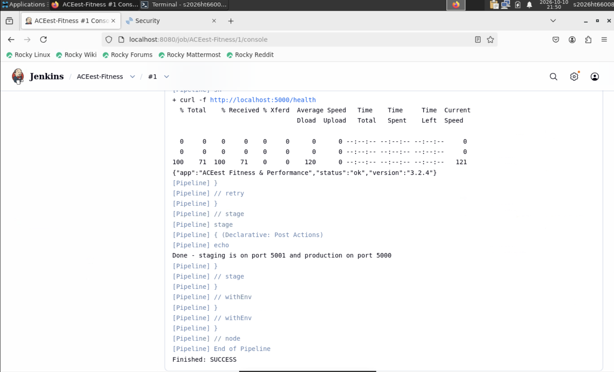

The quality gate result inside the pipeline log:

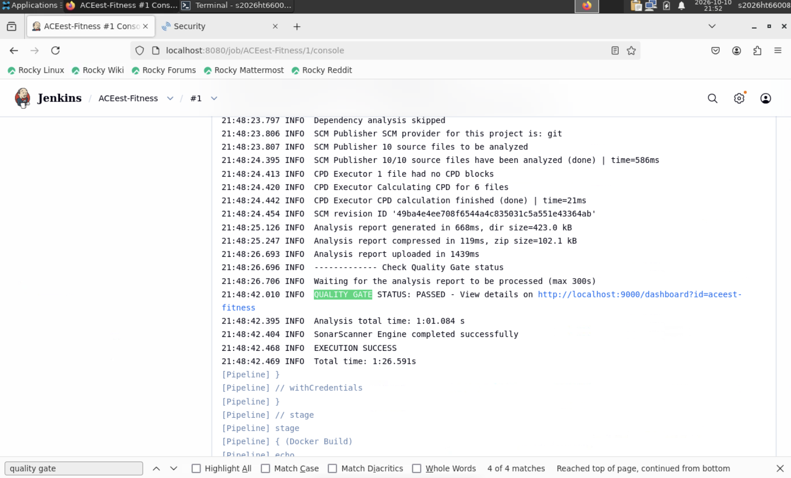

All stages green:

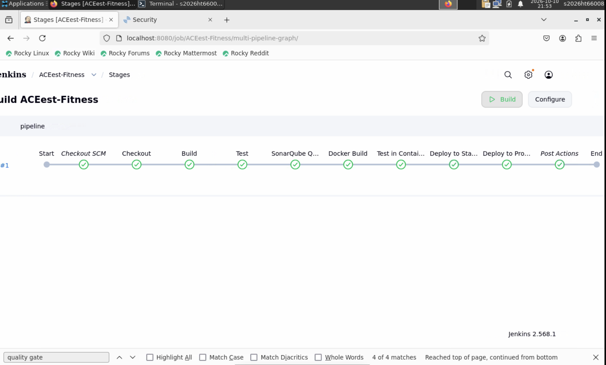

43 tests passed in the Test stage:

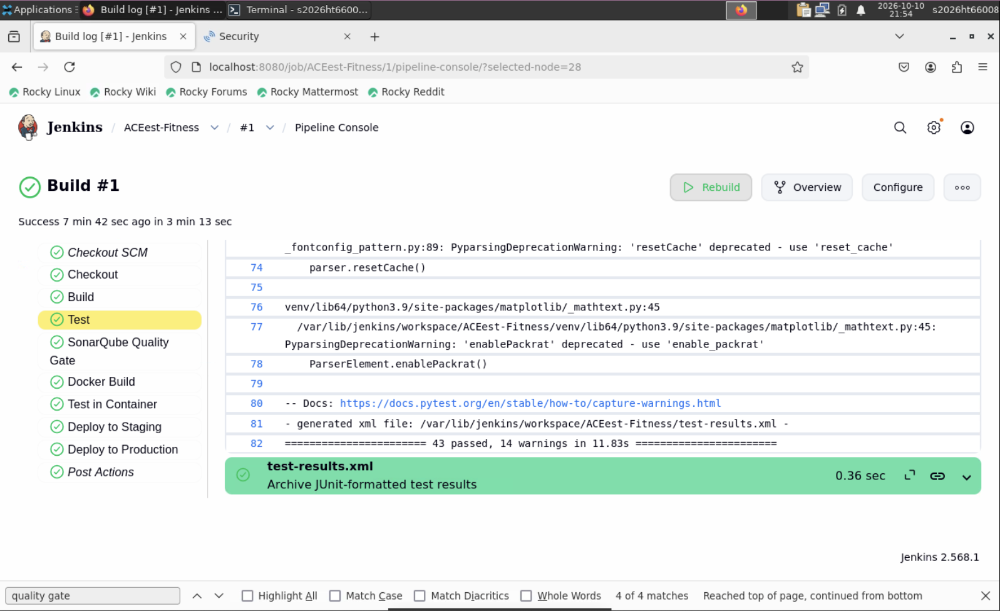

### SonarQube

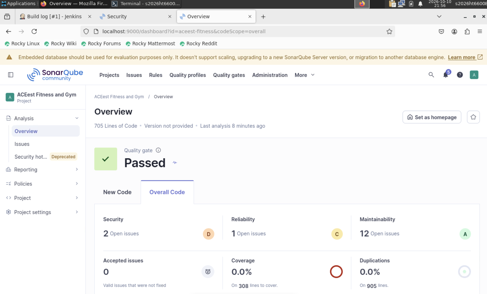

### Staging and production

Health checks and running containers on the VM:

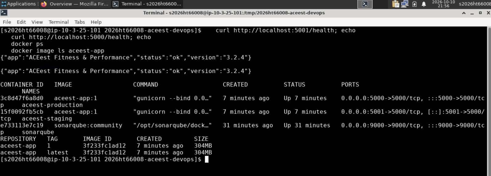

Staging (port 5001):

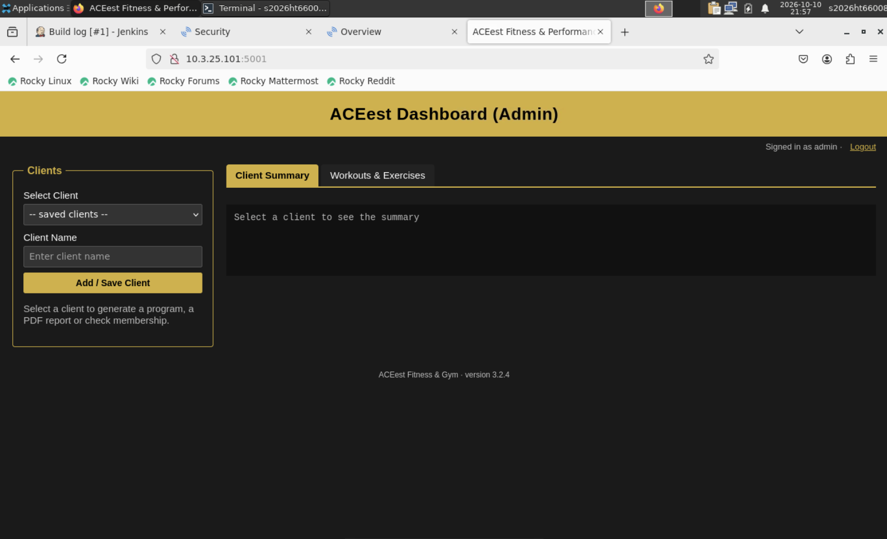

Production (port 5000):

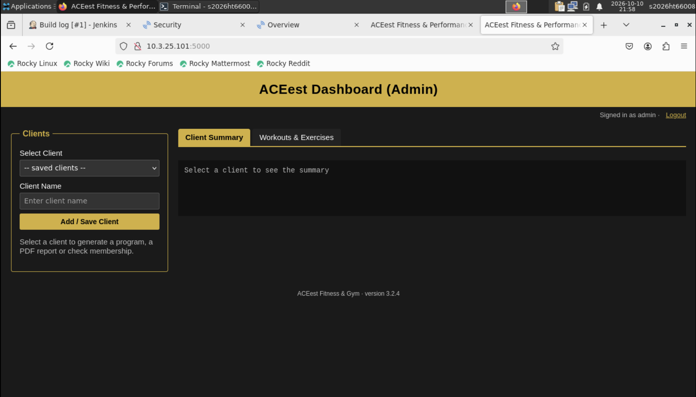

### Breaking a test on purpose

GitHub Actions goes red and the PR can't be merged:

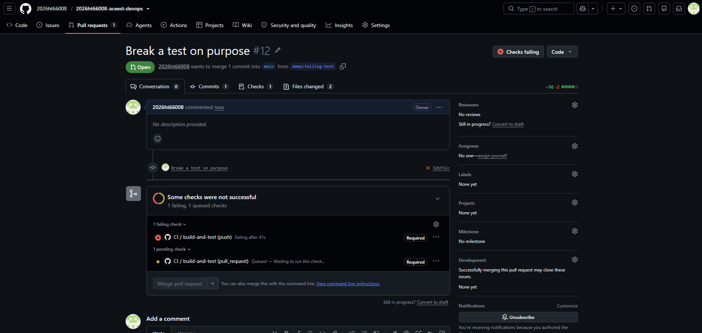

Jenkins build #2 stops at Test, so nothing gets deployed:

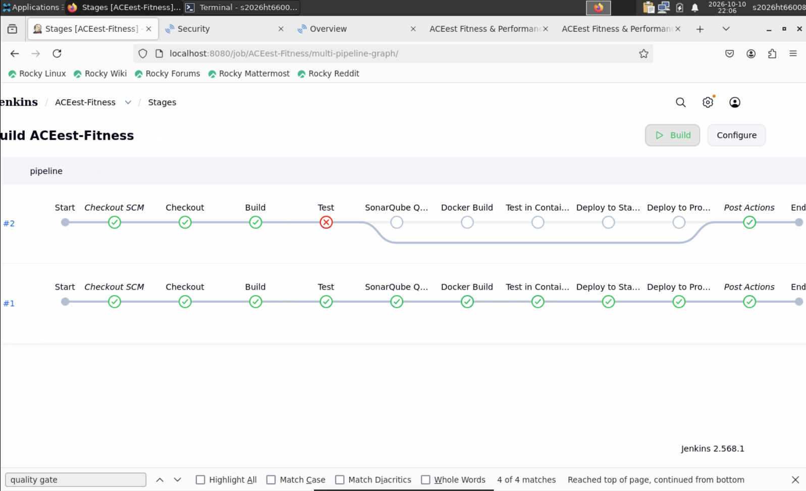

Production is still on the good build:

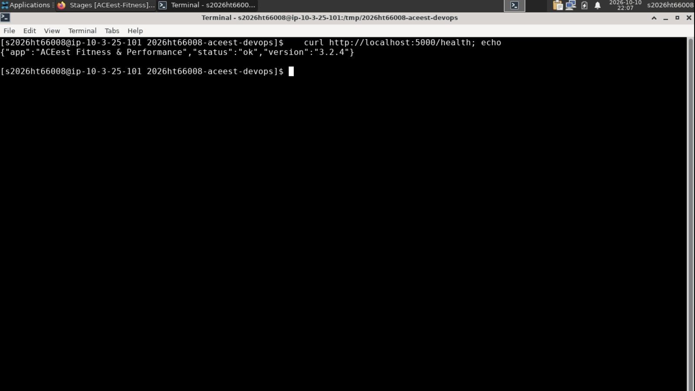

### GitHub

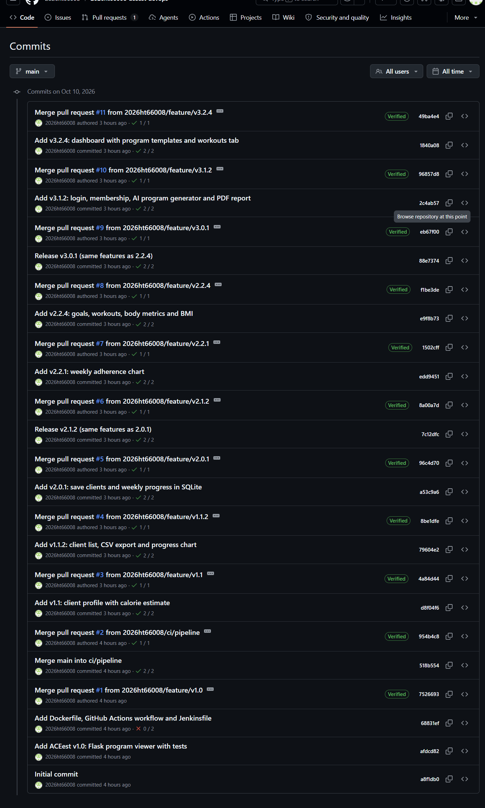

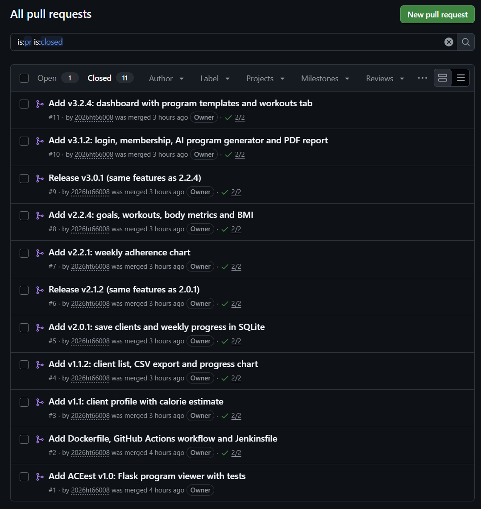

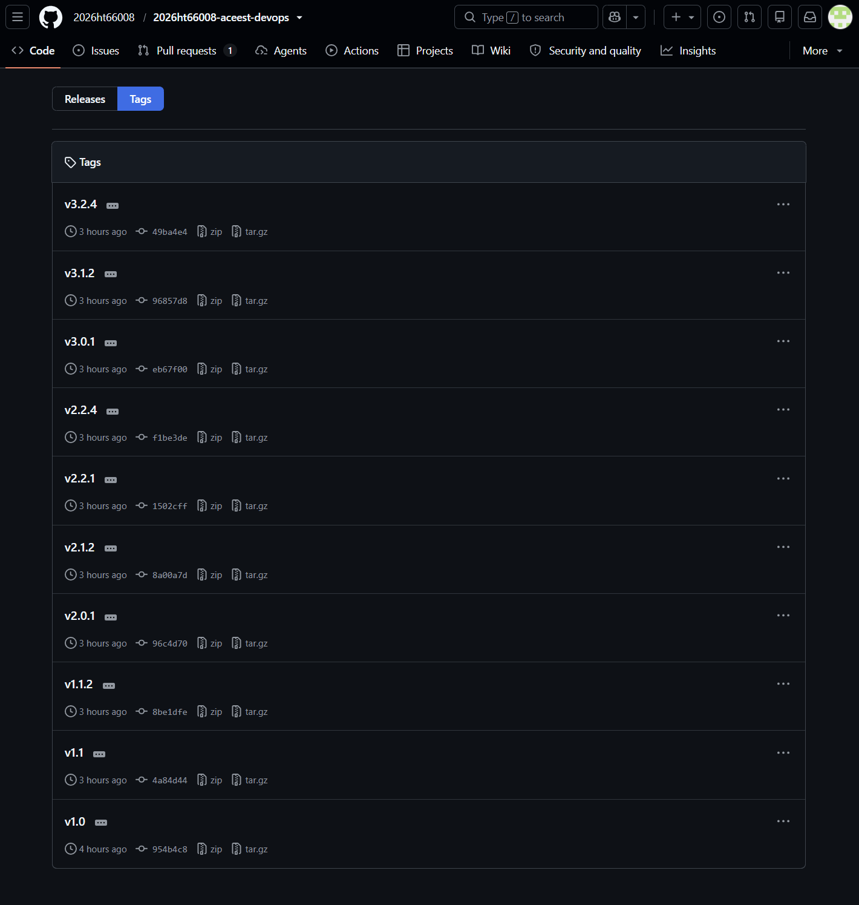

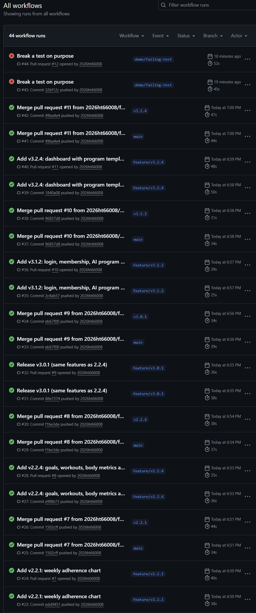
